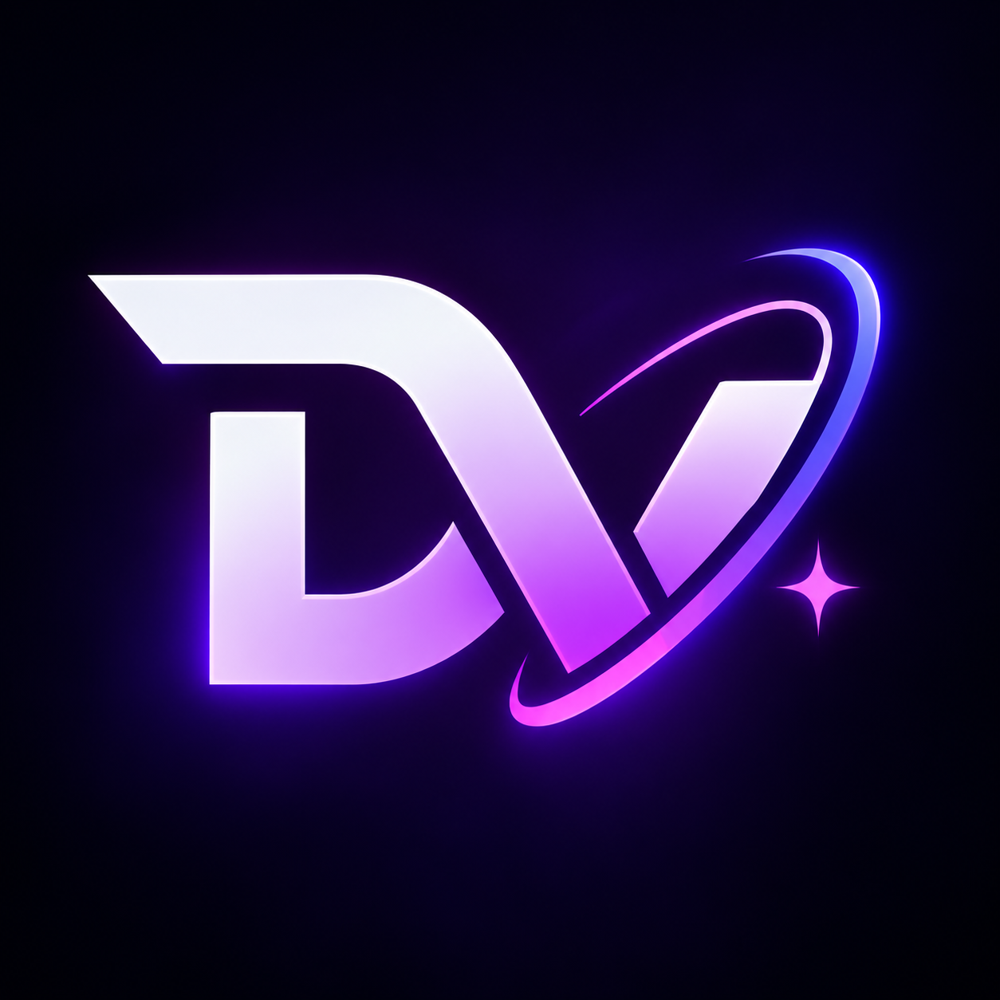

<div align="center">



# Digital Vigital (DV) Launcher
### *Your Minecraft. Your Control.*

[](https://github.com/SYN606/dv-client)
[](https://discord.gg/flex-dv)
[](https://digitalvigital.fun/minecraft)

A modern, ultra-fast Minecraft launcher designed for gamers who care about speed, clean design, and privacy. Built completely from the ground up in Rust - zero lag, zero bloat, and maximum FPS.

</div>

## Why Choose DV Launcher?

### Blazing Fast & Lightweight
Powered by Rust, Tauri v2, and Svelte for an ultra-low memory footprint, instant startup, and buttery-smooth responsive UI. DV uses virtually zero background memory and leaves all your PC's power where it belongs: **inside Minecraft**.

### All Versions & Loaders in One Place
Switch seamlessly between any version of Minecraft:
- **Vanilla** (All releases & snapshots)
- **Fabric** & **Quilt**
- **Forge** & **NeoForge**
- **OptiFine**

### Built-in Mod Store & Manager
- **Browse Modrinth Directly**: Search thousands of mods with full logos, descriptions, and download counts right inside the launcher.
- **1-Click Installs**: Add mods with a single click - no manual dragging into folders needed.
- **Easy Mod Manager**: Enable, disable, or remove your mods with a simple toggle switch.

### Smart GPU Auto-Detection (Max FPS)
Never let Minecraft accidentally run on weak integrated graphics again. DV automatically detects your **NVIDIA GeForce** or **AMD Radeon** graphics card and forces high-performance mode so you get buttery-smooth framerates.

### 100% Private & Secure
- **No Trackers or Ads**: We don't track your gameplay, collect telemetry, or spy on your computer.
- **Safe Accounts**: Full support for both **Microsoft Accounts** and **Offline Profiles**. Your login tokens are kept locked in your operating system's native hardware vault.

### Discord Rich Presence
Show off what you're playing to your friends on Discord with custom status display:  
*"Playing Minecraft via Digital Vigital"*

## Getting Started

### 1. Download & Prerequisites
Make sure you have a modern **Java** installed (Java 21 is recommended for latest Minecraft versions):
- **Windows**: [Eclipse Temurin JDK 21](https://adoptium.net/) or Microsoft OpenJDK
- **Linux**: Available via your package manager (`sudo dnf install java-21-openjdk` or `sudo apt install openjdk-21-jre`)

### 2. Run the Launcher

#### From Pre-built Executable
Simply download and run `dv-launcher-app.exe` (or `DigitalVigital-Setup-1.0.0.exe` installer).

#### From Source
```bash
# Clone the repository
git clone https://github.com/SYN606/dv-client
cd dv-client

# Build frontend & run desktop app
cd frontend
bun install
bun run build
cd src-tauri
cargo run --release
```

## Key Features at a Glance

| Feature | What It Means for You |
| :--- | :--- |
| **Multi-Profile System** | Keep different worlds, modpacks, and versions completely separate with their own saves and configs. |
| **Fast Downloader** | Multi-threaded downloads pull game assets and libraries at maximum internet speed. |
| **Custom Memory Slider** | Allocate exactly as much RAM (e.g. 4GB, 8GB, 16GB) as your modpack needs. |
| **Live Game Console** | View real-time logs and crash reports if a mod misbehaves. |
| **Wayland & Dark Mode** | Sleek Obsidian & Crimson gamer theme with native Linux Wayland and Windows 10/11 support. |

## Community & Support

Have questions, suggestions, or want to hang out with other players?

- **Official Website**: [digitalvigital.fun](https://digitalvigital.fun/minecraft)
- **Discord Community**: [discord.gg/flex-dv](https://discord.gg/flex-dv)
- **Report an Issue**: Open an issue on our [GitHub repository](https://github.com/SYN606/dv-client/issues)


## Legal Notice

*Minecraft is a registered trademark of Mojang Synergies AB and Microsoft Corporation. Digital Vigital Launcher is an independent open-source project and is not affiliated with, endorsed by, or sponsored by Mojang Studios or Microsoft.*
